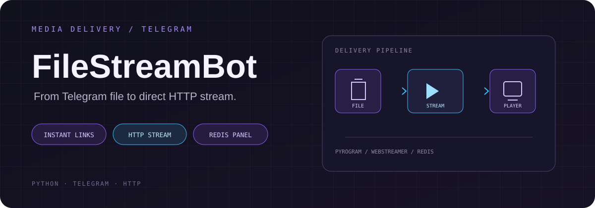
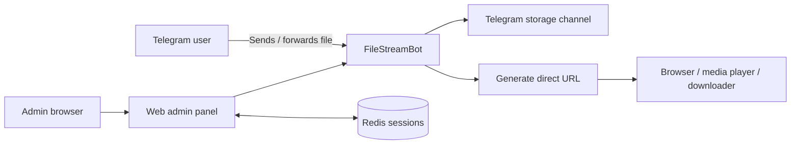

<div align="center">



**Turn Telegram files into direct links you can stream or download.**

[Features](#what-it-does) · [How it works](#the-flow) · [Install](#installation) · [Configure](#configuration) · [Admin panel](#admin-panel)

<br/>


[فارسی](READMEfa.md)

</div>

---

## What it does

**FileStreamBot** is a Telegram bot that turns files sent to it into direct HTTP links. Links are generated without first downloading the complete file to your own server, allowing compatible browsers, players and download managers to consume the content over HTTP.

The project also includes a persistent web administration panel backed by Redis.

### At a glance

| Capability | Description |
|---|---|
| Direct links | Generate a shareable HTTP URL for a Telegram file |
| Streaming | Open supported media without waiting for a full server-side download |
| Large files | File handling follows Telegram's applicable file and API limits |
| Access control | Restrict bot usage to authorized users and channels |
| Admin panel | Manage users and inspect bot statistics |
| Persistent sessions | Redis-backed admin sessions survive application restarts |
| Admin security | Password hash storage and CSRF protection |

## The flow



## Installation

### Requirements

- Python 3
- Telegram API credentials from [my.telegram.org](https://my.telegram.org)
- A bot token from [@BotFather](https://t.me/BotFather)
- A Telegram channel where the bot can store/forward files
- Redis for persistent admin sessions

### 1. Clone the repository

```bash
git clone https://github.com/iaMaSTeR-Dev/FileStreamBot.git
cd FileStreamBot
```

### 2. Install Redis

On Debian / Ubuntu:

```bash
sudo apt update
sudo apt install redis-server -y
sudo systemctl enable --now redis-server
```

Confirm Redis is running:

```bash
redis-cli ping
```

Expected response:

```text
PONG
```

### 3. Create a virtual environment

Linux / macOS:

```bash
python3 -m venv venv
source venv/bin/activate
```

Windows PowerShell:

```powershell
python -m venv venv
.\venv\Scripts\Activate.ps1
```

### 4. Install Python dependencies

```bash
pip install -r requirements.txt
```

## Configuration

Create a `.env` file in the project root and fill in the values:

```dotenv
# Telegram API credentials — https://my.telegram.org
API_ID=
API_HASH=

# Bot token — https://t.me/BotFather
BOT_TOKEN=

# Storage channel ID. The bot must be an administrator there.
# Private channel IDs commonly look like -100123456789.
BIN_CHANNEL=

# Telegram numeric user ID of the owner
OWNER_ID=

# HTTP server
PORT=8080
FQDN=
HAS_SSL=false

# Pyrogram session persistence
USE_SESSION_FILE=true

# Web admin account
ADMIN_USERNAME=
ADMIN_PASSWORD_HASH=

# Redis connection for persistent admin sessions
REDIS_URL=redis://localhost:6379/0
```

| Variable | Purpose |
|---|---|
| `API_ID`, `API_HASH` | Telegram application credentials |
| `BOT_TOKEN` | BotFather token |
| `BIN_CHANNEL` | Channel used for file storage; add the bot as an administrator |
| `OWNER_ID` | Numeric Telegram ID of the owner |
| `PORT` | HTTP server port; defaults to `8080` |
| `FQDN` | Public hostname or IP used when generating links |
| `HAS_SSL` | Set to `true` when links use HTTPS |
| `USE_SESSION_FILE` | Whether to persist Pyrogram session files |
| `ADMIN_USERNAME` | Admin panel username |
| `ADMIN_PASSWORD_HASH` | Password hash used by the admin panel |
| `REDIS_URL` | Redis connection URL |

### Generate the admin password hash

Do not put a plaintext admin password in `ADMIN_PASSWORD_HASH`.

```bash
python3 generate_hash.py
```

Enter your chosen password when prompted, then copy the generated hash into `.env`.

## Run

Start the application from the repository root:

```bash
python3 -m WebStreamer
```

The bot and its HTTP streaming service will start using the configured environment.

## Admin panel

Open the admin login page:

```text
http://<FQDN>:<PORT>/admin/login
```

Sign in with `ADMIN_USERNAME` and the password corresponding to `ADMIN_PASSWORD_HASH`.

The panel provides:

- Bot statistics
- User management (add/remove)
- Persistent login sessions through Redis
- Administrative controls exposed by the application

For production, put the service behind HTTPS, keep Redis private, use a strong admin password and restrict access to the admin route at the network layer where possible.

## Operational notes

- The bot must have the required permissions in `BIN_CHANNEL`.
- Make sure `FQDN` resolves to the server that hosts the HTTP service.
- Set `HAS_SSL=true` only when the public endpoint is actually served over HTTPS.
- Keep `.env`, Telegram credentials, session files and Redis credentials out of version control.
- Generated URLs are only as reliable as the bot's Telegram access, server availability and public network configuration.

## Support the project

If this project is useful to you, you can support its maintenance:

| Network | Address |
|---|---|
| USDT (TRC20) | `TWKQ8QSinouRAMZ4cSorMNfWb2XBHFSRL1` |
| USDT (BEP20) | `0x10E8170eb6251801093e9388e2Ff09419E4cf365` |
| LTC | `ltc1qnhcus0jmvxhhc3mdshf3hg832nwglukk6a2kxs` |
| GRAM | `UQAgMDdXQEkJwdAAY7AxWB8ULXU7J1Up74pyG-_DJPSQbEJh` |

## Contributing

Issues and pull requests are welcome. Please include a clear description of the problem or proposed change.

- [Open an issue](https://github.com/iaMaSTeR-Dev/FileStreamBot/issues)
- [Browse the repository](https://github.com/iaMaSTeR-Dev/FileStreamBot)

## Credits

This project is a forked and improved version of [TG-FileStreamBot](https://github.com/EverythingSuckz/TG-FileStreamBot).

## License

Licensed under the **GNU Affero General Public License v3.0**. See [`LICENSE`](LICENSE).

---

<div align="center">

**FileStreamBot** · Your Telegram files, ready to stream.

Maintained by [iaMaSTeR-Dev](https://github.com/iaMaSTeR-Dev)

</div>
